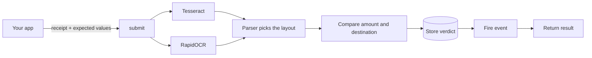

# Transaction Verification for Laravel

[](https://github.com/Ergasti/transaction-verification/actions/workflows/tests.yml)
[](https://github.com/Ergasti/transaction-verification/releases)


**Check a payout receipt against what you expected to pay.**

Give this package a receipt screenshot or PDF, the amount, and where the money should have gone. It reads the receipt with OCR, compares the two, and gives you a verdict: `match`, `mismatch`, `needs_review` or `unreadable`.

> **It warns, it never blocks.** A verdict is advice for a person. The package holds no payout and changes no status of yours; what happens next is up to your app. Anything unsure goes to `needs_review`.

```php
$result = $verifier->submit(new VerificationRequest(
    subjectType: 'payout',
    subjectId: $payoutId,
    expectedAmountMinor: 307000, // 3,070.00 EGP in piastres
    expectedDestination: new ExpectedDestination(DestinationTypeEnum::PHONE, '01000000001'),
    file: $request->file('receipt'),
    idempotencyKey: "payout:{$payoutId}",
));

$result->verdict; // VerdictEnum::MATCH
```

---

## 📑 Table of Contents

- [✨ Features](#-features)
- [🚫 What It Does Not Do](#-what-it-does-not-do)
- [📐 How It Works](#-how-it-works)
- [🚀 Installation](#-installation)
  - [Compatibility](#compatibility)
  - [Quick Start](#quick-start)
  - [Step by Step](#step-by-step)
- [🔧 Configuration](#-configuration)
- [📖 Usage](#-usage)
  - [1. Check a Receipt](#1-check-a-receipt)
  - [2. React to a Verdict](#2-react-to-a-verdict)
  - [3. Read a Result Later](#3-read-a-result-later)
  - [4. Accept More Than One Destination](#4-accept-more-than-one-destination)
  - [5. Check a File Already on Disk](#5-check-a-file-already-on-disk)
  - [6. Handle Failures and Retries](#6-handle-failures-and-retries)
- [🚦 Verdicts and Statuses](#-verdicts-and-statuses)
- [🧾 Supported Receipts](#-supported-receipts)
- [🔍 OCR Engines](#-ocr-engines)
- [🌐 HTTP API](#-http-api)
  - [Switching It On](#switching-it-on)
  - [Endpoints](#endpoints)
  - [Signing a Request](#signing-a-request)
  - [Submitting a Receipt](#submitting-a-receipt)
  - [Errors](#errors)
- [🧰 Artisan Commands](#-artisan-commands)
- [💾 Database Schema](#-database-schema)
- [🔒 Security and Privacy](#-security-and-privacy)
- [🆙 Upgrading](#-upgrading)
- [🩺 Troubleshooting](#-troubleshooting)
- [🧪 Testing](#-testing)
- [📚 API Reference](#-api-reference)
- [📜 License](#-license)

---

## ✨ Features

- **Reads real receipts:** InstaPay (English or Arabic, older and newer layouts) and AlexBank "Pay someone" confirmations, as an image or a PDF.
- **Two OCR engines by default:** Tesseract and RapidOCR read each receipt, and a deciding field only counts when both agree.
- **Deterministic decisions:** plain comparison rules produce the verdict. No AI model decides anything.
- **Receipts are never stored:** the file is read straight from the upload and left where it was.
- **Runs entirely on your server:** no cloud OCR service and no API key.
- **Sensitive fields encrypted:** the destination and everything read from the receipt are encrypted at rest with your `APP_KEY`.
- **Safe to retry:** the same `idempotencyKey` always returns the existing result.
- **Works from PHP or over HTTP:** call it in-process, or let another app use the signed internal API.
- **Shadow mode built in:** a CSV report lets you measure accuracy before anyone relies on a verdict.

## 🚫 What It Does Not Do

Knowing the limits matters as much as the features.

| It does not | So you should |
|---|---|
| Block or hold a payout | Decide in your own app what each verdict means |
| Tell whether an image is genuine | Treat a `match` as "the receipt shows the right values", not as proof of payment |
| Detect a receipt used twice | Check for reuse yourself if you need to (this was removed in 0.7.0) |
| Compare the currency or the date | Rely on it for EGP receipts only. Other currencies are not compared |
| Let the reference number affect the verdict | Use the reference for your records only |
| Read other banks' own receipt layouts | Expect `unreadable` for anything except the [supported receipts](#-supported-receipts) |
| Read past the first page of a PDF | Send single-page PDFs |
| Queue, retry or delete anything | Run it where you like, and add your own retention policy |

## 📐 How It Works



1. Your app calls `submit()` with the receipt and the expected amount and destination.
2. If that `idempotencyKey` was already used, the existing result comes back at once. Otherwise a row is created.
3. Tesseract and RapidOCR read the receipt. See [OCR Engines](#-ocr-engines) for the details.
4. The first parser that recognises the layout pulls out the amount, destination, reference and date.
5. The amount and destination are compared with what you expected, and that decides the [verdict](#-verdicts-and-statuses).
6. The result is stored, `TransactionVerificationCompleted` fires, and `submit()` returns the result.

`submit()` is **synchronous** and usually takes a few seconds, so in a web request run it [after the response is sent](#1-check-a-receipt). There is no queue job to run.

## 🚀 Installation

### Compatibility

| Requirement | Version | Notes |
|---|---|---|
| PHP | 8.3 or newer | With `ext-gd`. `ext-exif` is optional and turns phone photos upright. WebP needs a GD build with WebP support |
| Laravel | 11 or 12 | The test suite runs on Laravel 11. Laravel 12 is allowed by `composer.json` but is not run in CI |
| Database | Any Laravel connection | The test suite runs on SQLite |
| Tesseract | With Arabic and English data | Required by default |
| Poppler (`pdftoppm`) | Any | Only needed for PDF receipts |
| `proc_open` | Enabled | The OCR engines run as separate processes |

| Platform | RapidOCR engine | Download |
|---|---|---|
| Linux x86_64 | Built, needs glibc 2.35 or newer (Ubuntu 22.04 and up) | about 236 MB |
| macOS on Apple Silicon | Built, needs macOS 14 or newer. For development | about 131 MB |
| Anything else | Run it [over HTTP yourself](#-ocr-engines) | n/a |

### Quick Start

```bash
# 1. Install the package (it is on GitHub, no token needed)
composer config repositories.transaction-verification vcs https://github.com/Ergasti/transaction-verification
composer require ergasti/transaction-verification:^0.8

# 2. Create the table
php artisan migrate

# 3. Install the OCR engines (macOS: brew install tesseract tesseract-lang poppler)
sudo apt install tesseract-ocr tesseract-ocr-ara tesseract-ocr-eng poppler-utils
php artisan transaction-verification:install-ocr
```

That's it. No `.env` entries are required, there is nothing to publish, and no queue worker is needed. Now [check your first receipt](#1-check-a-receipt).

### Step by Step

**1. Require the package.** Laravel discovers the service provider by itself.

```bash
composer config repositories.transaction-verification vcs https://github.com/Ergasti/transaction-verification
composer require ergasti/transaction-verification:^0.8
```

A busy CI can hit GitHub's limit for anonymous requests. A token with no scopes in `COMPOSER_AUTH` lifts it.

**2. Choose the database connection (optional).** The table goes on your default connection. To use another one, set this **before the first `migrate`**:

```dotenv
TRANSACTION_VERIFICATION_DB_CONNECTION=your_connection
```

> Changing it after migrating is not enough. Laravel remembers the migration as already run, so `php artisan migrate` will **not** create the table on the new connection. Delete this migration's row from your `migrations` table, then migrate again.

**3. Create the table.**

```bash
php artisan migrate
```

**4. Install the system packages.** Do this before the next step, because `install-ocr` exits with an error when Tesseract is missing, which would fail a deploy script.

```bash
# Ubuntu / Debian
sudo apt install tesseract-ocr tesseract-ocr-ara tesseract-ocr-eng poppler-utils

# macOS
brew install tesseract tesseract-lang poppler
```

**5. Install the RapidOCR engine.**

```bash
php artisan transaction-verification:install-ocr
```

This downloads the engine matching your package version, verifies its SHA256 before unpacking, and starts it once to prove it runs. It carries its own interpreter and models, so you don't need Docker or Python, and servers don't need internet access on the first read. Nothing listens on a port: your app starts the engine for one receipt and it exits.

It installs to `storage/app/transaction-verification/ocr`. That directory must be writable and allowed to run programs (not mounted `noexec`), and it must either survive your deploys or be reinstalled on each one. **After every package upgrade, run the command again with `--force`.**

**6. Keep the scheduler running.** Every 5 minutes it marks as `failed` any check that died part-way, so a person looks at that receipt. Everything else works without it.

**7. Keep `APP_KEY` stable.** Encrypted columns use it. To change it, rotate through Laravel's `APP_PREVIOUS_KEYS`.

## 🔧 Configuration

**You don't need to configure anything.** Every setting below has a working default. All variables start with `TRANSACTION_VERIFICATION_`.

| Variable | Default | What it does |
|---|---|---|
| `_DB_CONNECTION` | app default | Database connection for the table |
| `_CONFIDENCE` | `0.90` | Below this, a deciding field can't produce `match` or `mismatch`, only `needs_review` |
| `_MAX_FILE_BYTES` | `10485760` | Largest receipt it will read (10 MiB) |
| `_STALE_MINUTES` | `15` | How old a stuck check must be before it is marked `failed`. Must be longer than your slowest check |
| `_ENABLED` | `true` | **The package doesn't read this.** It exists for your own code to check. To switch off the API use `_API_ENABLED` |

**OCR**

| Variable | Default | What it does |
|---|---|---|
| `_SECOND_ENGINE` | `always` | `always`, `fallback` or `off`. See [OCR Engines](#-ocr-engines). Any other value is treated as `always` |
| `_ENGINE` | `tesseract` | The first engine. Only `tesseract` selects it; **any other value, typos included, selects an engine that reads nothing** |
| `_TESSERACT_BINARY` | `tesseract` | Path to Tesseract |
| `_PDFTOPPM_BINARY` | `pdftoppm` | Path to `pdftoppm` |
| `_TESSERACT_PARALLEL` | `4` | Passes to run side by side. `1` runs them one at a time |
| `_TESSERACT_EARLY_PASSES` | `2` | On `always`, passes to read first; the rest run only if the engines disagree. `0` reads every pass |
| `_RAPIDOCR_BINARY` | `storage/app/transaction-verification/ocr/tv-ocr` | Path to the engine. `install-ocr` always installs to the default place |
| `_RAPIDOCR_URL` | none | An HTTP RapidOCR server, used only when no binary file exists |

**HTTP API**

| Variable | Default | What it does |
|---|---|---|
| `_API_ENABLED` | `false` | While off, every API request gets `503` |
| `_API_KEY_ID` | `caller` | The caller's key id |
| `_API_SECRET` | empty | The shared signing secret. An empty secret can never sign, so the API stays closed |
| `_API_SECRET_PREV` | empty | The old secret, only while rotating |
| `_API_IPS` | empty | Optional caller IPs, comma-separated |

<details>
<summary><strong>Changing a setting that has no variable</strong></summary>

The Tesseract languages (`ara+eng`), passes and timeout (15 s), the RapidOCR timeout (20 s), the parser list, and additional API callers have no variable. There is no `vendor:publish` tag, so copy the config file:

```bash
cp vendor/ergasti/transaction-verification/config/transaction-verification.php config/
```

Copy the whole file rather than writing just the part you want to change. Laravel merges package config one level deep, so a partial `tesseract`, `second_engine`, `parsers` or `api` array would replace the package's entire array.

</details>

## 📖 Usage

Resolve or type-hint `Modules\TransactionVerification\Contracts\TransactionVerifier`. Amounts are always in **minor units** (piastres), so 3,070.00 EGP is `307000`.

### 1. Check a Receipt

This controller accepts the upload, answers straight away, and checks the receipt afterwards so the user never waits. The upload stays on disk until the request ends.

```php
<?php

namespace App\Http\Controllers;

use Illuminate\Http\JsonResponse;
use Illuminate\Http\Request;
use Modules\TransactionVerification\Contracts\TransactionVerifier;
use Modules\TransactionVerification\Data\ExpectedDestination;
use Modules\TransactionVerification\Data\VerificationRequest;
use Modules\TransactionVerification\Enums\DestinationTypeEnum;

class PayoutReceiptController
{
    public function store(Request $request, TransactionVerifier $verifier, string $payoutId): JsonResponse
    {
        // The package has no file-type allowlist for PHP callers, so validate here.
        $request->validate(['receipt' => ['required', 'file', 'mimes:jpeg,png,webp,pdf', 'max:10240']]);
        $receipt = $request->file('receipt');

        app()->terminating(function () use ($verifier, $receipt, $payoutId) {
            try {
                $verifier->submit(new VerificationRequest(
                    subjectType: 'payout',
                    subjectId: $payoutId,
                    expectedAmountMinor: 307000,
                    expectedDestination: new ExpectedDestination(DestinationTypeEnum::PHONE, '01000000001'),
                    file: $receipt,
                    idempotencyKey: "payout:{$payoutId}",
                ));
            } catch (\Throwable $e) {
                report($e); // Invalid input, or the row could not be created. A bad receipt never lands here.
            }
        });

        return response()->json(['received' => true], 202);
    }
}
```

| Destination type | `value` | How it is compared |
|---|---|---|
| `DestinationTypeEnum::PHONE` | `01000000001` | Normalised, and must be an Egyptian mobile number |
| `DestinationTypeEnum::INSTAPAY_HANDLE` | `name@instapay` | Ignoring case and surrounding spaces |
| `DestinationTypeEnum::BANK` | The account number | Only the digits are compared |

### 2. React to a Verdict

`TransactionVerificationCompleted` fires once a new check stores its verdict. It carries no phone number, image or OCR text.

```php
// In a service provider's boot()
use Illuminate\Support\Facades\Event;
use Modules\TransactionVerification\Events\TransactionVerificationCompleted;

Event::listen(function (TransactionVerificationCompleted $event) {
    // $event->uuid, $event->subjectType, $event->subjectId,
    // $event->verdict ('match', 'mismatch', 'needs_review' or 'unreadable'), $event->checks
});
```

It does not fire for a failed check or a repeated `idempotencyKey`. If you call `submit()` inside your own `DB::transaction`, the event waits for the commit, and a listener that throws will escape from your transaction. Calling `submit()` after the commit avoids this.

### 3. Read a Result Later

```php
use Modules\TransactionVerification\Contracts\TransactionVerifier;
use Modules\TransactionVerification\Enums\VerdictEnum;
use Modules\TransactionVerification\Enums\VerificationStatusEnum;

$verifier = app(TransactionVerifier::class);

$result = $verifier->latestFor('payout', 99);   // newest check for this subject, or null
$result = $verifier->find($uuid);                         // one check by uuid, or null

if ($result?->status === VerificationStatusEnum::COMPLETED && $result->verdict === VerdictEnum::MATCH) {
    $result->checks['amount']['found'];  // 307000
    $result->extracted['phone'];         // '01000000001'
}
```

A result looks like this:

```text
status:    COMPLETED
verdict:   MATCH
error:     null
checks:    amount      => [outcome: pass, expected: 307000, found: 307000]
           destination => [outcome: pass]
           reference   => [outcome: pass]
extracted: amount_minor, currency, phone, handle, account, reference, occurred_at, format
```

`extracted` always has those eight keys, with **full, unmasked values**. If you show them somewhere less trusted, mask them yourself.

### 4. Accept More Than One Destination

If the money may rightly go to more than one place, pass the others as `alternativeDestinations`. A payee's bank account may also be reachable by their phone on InstaPay, so a receipt showing only that phone is still right:

```php
new VerificationRequest(
    subjectType: 'payout',
    subjectId: $payoutId,
    expectedAmountMinor: 307000,
    expectedDestination: new ExpectedDestination(DestinationTypeEnum::BANK, '1000 0000 0000-0000 010'),
    file: $receipt,
    idempotencyKey: "payout:{$payoutId}",
    alternativeDestinations: [new ExpectedDestination(DestinationTypeEnum::PHONE, '01000000001')],
);
```

The best outcome decides. This option exists in PHP only; the HTTP API accepts one destination.

### 5. Check a File Already on Disk

`file` must be an `UploadedFile`, so wrap the path. Pass `true` as the last argument to mark it as a test file, which lets a file that wasn't uploaded in this request through:

```php
use Illuminate\Http\UploadedFile;

$file = new UploadedFile($path, 'receipt', $mimeType, UPLOAD_ERR_OK, true);
```

**Checking old receipts.** The package doesn't keep receipts, so it has no backfill command. Your app does it, with one queued job per receipt.

**1. Add this job.** `Payout`, `receipt_path`, `amount_minor` and `phone` are examples, so use your own model and columns.

```php
<?php

namespace App\Jobs;

use App\Models\Payout;
use Illuminate\Contracts\Queue\ShouldQueue;
use Illuminate\Foundation\Queue\Queueable;
use Illuminate\Http\UploadedFile;
use Illuminate\Support\Facades\Storage;
use Modules\TransactionVerification\Contracts\TransactionVerifier;
use Modules\TransactionVerification\Data\ExpectedDestination;
use Modules\TransactionVerification\Data\VerificationRequest;
use Modules\TransactionVerification\Enums\DestinationTypeEnum;

class CheckOldReceipt implements ShouldQueue
{
    use Queueable;

    public function __construct(public int $payoutId) {}

    public function handle(TransactionVerifier $verifier): void
    {
        $payout = Payout::findOrFail($this->payoutId);

        $temp = tempnam(sys_get_temp_dir(), 'receipt');
        file_put_contents($temp, Storage::get($payout->receipt_path));

        try {
            $verifier->submit(new VerificationRequest(
                subjectType: 'payout',
                subjectId: $payout->id,
                expectedAmountMinor: $payout->amount_minor,
                expectedDestination: new ExpectedDestination(DestinationTypeEnum::PHONE, $payout->phone),
                file: new UploadedFile($temp, 'receipt', mime_content_type($temp), UPLOAD_ERR_OK, true),
                idempotencyKey: "payout:{$payout->id}",
            ));
        } finally {
            unlink($temp);
        }
    }
}
```

**2. Queue the receipts**, from `php artisan tinker` or a command of your own:

```php
Payout::whereNotNull('receipt_path')->pluck('id')->each(fn ($id) => CheckOldReceipt::dispatch($id));
```

**3. Start a worker.** `QUEUE_CONNECTION` must be a real queue such as `database` or `redis`. Start with one worker, because each check is heavy.

```bash
php artisan queue:work
```

Only have a few receipts? Skip the worker and run them straight away with `CheckOldReceipt::dispatchSync($id)`.

Receipts that already have a result are skipped as long as you keep the same `idempotencyKey`. To check one again, use a new key.

`TransactionVerificationCompleted` fires for each receipt, so make sure your listeners won't notify anyone about old payouts.

### 6. Handle Failures and Retries

| What happened | Result |
|---|---|
| Corrupt file, file too large, Tesseract missing or crashing, PDF without Poppler | `status = failed`, `verdict = null`, the reason in `error` |
| OCR ran but read nothing, or the layout is unknown | `status = completed`, `verdict = unreadable` |
| RapidOCR is down or not installed | The check still finishes. On `always` a would-be `match` becomes `needs_review` |
| Invalid arguments | `VerificationRequest` throws `InvalidArgumentException` when you construct it |
| The row can't be created | `submit()` throws |

**A failed result stays attached to its key.** Sending the same `idempotencyKey` again returns the same failure without reading the file. To read the receipt again, use a new key.

## 🚦 Verdicts and Statuses

**Verdicts.** The first rule that applies wins:

| Order | Verdict | Meaning |
|---|---|---|
| 1 | `unreadable` | The amount or the destination could not be read at all |
| 2 | `mismatch` | The amount or the destination was read with confidence and is different |
| 3 | `needs_review` | It differs but wasn't read with confidence, or the destination can't be confirmed, or a deciding field is unsure |
| 4 | `match` | Amount and destination were read with confidence and are what you expected |

**Checks** behind the verdict, in `$result->checks`:

| Check | Passes when | Affects the verdict |
|---|---|---|
| `amount` | Equal, or equal with the piastres dropped (17,906.59 expected, 17,906 on the receipt). Rounded up (17,907) fails | Yes |
| `destination` | Matches the expected value, or any alternative | Yes |
| `reference` | A reference was found. It isn't compared with anything | **No** |

Each check's outcome is `pass`, `fail`, `missing` or `not_applicable`.

Two cases worth knowing:

- A **bank** destination never fails or goes missing. If the account digits differ or weren't read, the outcome is `not_applicable`, which gives `needs_review`.
- An **InstaPay handle** gives `needs_review` when the receipt shows only a phone number.

**Statuses** describe the check itself, separately from the verdict:

| Status | Meaning |
|---|---|
| `processing` | The check is running |
| `completed` | A verdict was stored |
| `failed` | It could not finish. A person should look at the receipt |
| `pending` | Only on rows left by 0.1. Nothing creates it now |

## 🧾 Supported Receipts

The first parser that recognises the layout reads it, and the result is recorded as `format`.

| `format` | Receipt | Fields read |
|---|---|---|
| `instapay` | InstaPay app, English or Arabic, older and newer layouts | Amount, phone, handle or account, 12-digit reference, date, status, note |
| `alexbank` | AlexBank "Pay someone" confirmation (mobile wallet transfers) | Amount, wallet phone and status only. Several confirmations stacked in one image are added up, and each must name the same wallet |
| `unrecognised` | Anything else | Nothing useful, so the verdict is `unreadable` |

Accepted files are JPEG, PNG, WebP and PDF (first page only), up to 10 MiB. Images are limited to 30 million pixels. Arabic and Persian digits are handled.

An AlexBank receipt shows only a wallet phone, so it can't `match` a `bank` or `instapay_handle` destination unless you also pass the phone as an [alternative](#4-accept-more-than-one-destination).

Adding a layout means changing the package, because each parser needs a `ReceiptFormatEnum` case. The steps are to add the case, write a parser implementing `ReceiptParser` and `RecognisesReceipts`, and add it to `parsers` in the config. Order matters, since the first parser to recognise the text reads it.

## 🔍 OCR Engines

`_SECOND_ENGINE` decides how the two engines work together:

| Mode | Tesseract | RapidOCR | Result |
|---|---|---|---|
| `always` (default) | Reads the first 2 passes, and the rest only if the engines disagree | Reads every receipt | A field counts only when **both** read it the same. Otherwise it goes to review |
| `fallback` | Reads all passes first | Only when Tesseract is unsure | RapidOCR fills gaps and confirms unsure fields. A confidently wrong Tesseract read is never checked |
| `off` | Reads all passes | Never | Tesseract alone |

**Why two kinds of install?** Tesseract and Poppler come from your distribution, which signs and patches them. RapidOCR has no distribution package, so it is the one thing this package ships.

**Platform difference:** the macOS build runs on ONNX Runtime instead of OpenVINO, because PyInstaller can't bundle OpenVINO's macOS libraries. It is slower, which only matters during development.

**On any other platform** (an Intel Mac, another Linux architecture), run the engine yourself and point the package at it. It needs Python 3.11 or newer:

```bash
cd vendor/ergasti/transaction-verification
pip install -r ocr-sidecar/requirements.txt
python ocr-sidecar/server.py     # listens on 127.0.0.1:8080
```

```dotenv
TRANSACTION_VERIFICATION_RAPIDOCR_URL=http://127.0.0.1:8080
```

`OCR_BIND=0.0.0.0` changes the address, for example inside a container. **This server has no authentication**, so keep it on a private network.

## 🌐 HTTP API

**This is only for another app.** Code in the app that installed the package should use the PHP API above and needs no keys. The API **ships switched off**. The full contract is in [`openapi/transaction-verification-internal.yaml`](openapi/transaction-verification-internal.yaml).

### Switching It On

**1. Make a secret.**

```bash
php -r 'echo bin2hex(random_bytes(32)), PHP_EOL;'
```

**2. Set these in the app that installed the package**, then reload the config (`php artisan config:cache`).

```dotenv
TRANSACTION_VERIFICATION_API_KEY_ID=payouts-app         # lowercase letters, digits, - and _, up to 32
TRANSACTION_VERIFICATION_API_SECRET=the-secret          # keep this in your secret store, never in git
TRANSACTION_VERIFICATION_API_ENABLED=true
```

**3. Give the other app** the same key id and secret, plus your base URL.

- **To rotate:** put the new secret in `_API_SECRET` and the old one in `_API_SECRET_PREV`. Both work until the other app has switched. Then empty `_API_SECRET_PREV`.
- **To switch off** (for example, a leaked secret): set `_API_ENABLED=false` and reload the config. No deploy is needed.
- **For a second caller:** [copy the config file](#-configuration) and add an entry under `api.consumers`. All callers can see all results.

### Endpoints

The base path is `/api/internal/transaction-verification/v1`.

| Method | Path | Does |
|---|---|---|
| `POST` | `/verifications` | Checks a receipt and returns the finished result |
| `GET` | `/verifications?subject_type=&subject_id=` | A subject's checks, newest first (`page`, `per_page` up to 100, default 20) |
| `GET` | `/verifications/{uuid}` | One check |

Each key id gets 600 requests a minute, of which up to 30 can be `POST`s.

A successful response looks like this. A list returns `{"items": [...], "meta": {"current_page", "per_page", "last_page", "total"}}` as `data`.

```json
{
  "success": true,
  "data": {
    "uuid": "…",
    "subject_type": "payout",
    "subject_id": "123",
    "status": "completed",
    "verdict": "match",
    "checks": {"amount": {"outcome": "pass", "expected": 307000, "found": 307000}, "destination": {"outcome": "pass"}, "reference": {"outcome": "pass"}},
    "extracted": {"amount_minor": 307000, "currency": "EGP", "phone": "01000000000", "handle": null, "account": null, "reference": "100000000001", "occurred_at": null, "format": "instapay"},
    "error": null
  }
}
```

An unreadable receipt is still `200`, with `"status": "failed"` and a fixed message in `error`. Always check `status`.

### Signing a Request

Every request carries four headers:

| Header | Value |
|---|---|
| `X-Service-Key-Id` | The caller's key id |
| `X-Service-Timestamp` | Unix seconds, within 5 minutes of the server |
| `X-Service-Nonce` | 32 lowercase hex characters, new for every request including retries |
| `X-Service-Signature` | Lowercase hex HMAC-SHA256 of the string below, using the secret |

The signed string is five lines joined by `\n`, with no newline at the end:

```text
METHOD
/path?sorted=query
sha256 hex of the exact body bytes
timestamp
nonce
```

- The path has no host. Leave out the `?` when there is no query.
- Query pairs are sorted by key, exactly as sent, with no re-encoding.
- A `GET` hashes the empty string, `e3b0c44298fc1c149afbf4c8996fb92427ae41e4649b934ca495991b7852b855`.
- A query that names a key twice is refused, including encoded spellings such as `%73ubject_id`.

From Laravel:

```php
$path = '/api/internal/transaction-verification/v1/verifications';
$body = json_encode($payload);
$timestamp = (string) time();
$nonce = bin2hex(random_bytes(16));
$canonical = implode("\n", ['POST', $path, hash('sha256', $body), $timestamp, $nonce]);

$response = Http::withHeaders([
    'X-Service-Key-Id' => $keyId,
    'X-Service-Timestamp' => $timestamp,
    'X-Service-Nonce' => $nonce,
    'X-Service-Signature' => hash_hmac('sha256', $canonical, $secret),
])->withBody($body, 'application/json')->post($baseUrl.$path);
```

<details>
<summary><strong>Check your signer against this example</strong></summary>

The secret is a test value, never a real one.

```text
secret    : test_secret_do_not_use
method    : GET
path+query: /api/internal/transaction-verification/v1/verifications?subject_id=123&subject_type=payout
body sha  : e3b0c44298fc1c149afbf4c8996fb92427ae41e4649b934ca495991b7852b855
timestamp : 1700000000
nonce     : 0123456789abcdef0123456789abcdef
signature : a2860da04df71a64b5801c7b266c0e1abd54d42af536ccd2776180d21a9fb93f
```

</details>

<details>
<summary><strong>Try it with curl</strong></summary>

Needs bash, openssl, curl and jq 1.6 or newer. `openssl -hmac` exposes the secret in the process list, so use this for testing and sign from application code in production.

```bash
#!/usr/bin/env bash
set -euo pipefail

BASE_URL='https://your-app.example'
KEY_ID='payouts-app'
SECRET='REPLACE_WITH_SHARED_SECRET'
API_PATH='/api/internal/transaction-verification/v1/verifications'
RECEIPT='receipt.png'

body=$(mktemp); trap 'rm -f "$body"' EXIT

# The JSON goes to a file because a large receipt is too long for a command-line argument.
jq -n --rawfile file <(base64 < "$RECEIPT" | tr -d '\n') '{
  subject_type: "payout",
  subject_id: "7",
  expected_amount_minor: 307000,
  currency: "EGP",
  expected_destination: {type: "phone", value: "01000000000"},
  idempotency_key: "payout:7",
  context: {uploaded_by: "finance"},
  file_base64: $file
}' > "$body"

timestamp=$(date +%s)
nonce=$(openssl rand -hex 16)
body_hash=$(openssl dgst -sha256 < "$body" | awk '{print $NF}')

signature=$(printf '%s\n%s\n%s\n%s\n%s' POST "$API_PATH" "$body_hash" "$timestamp" "$nonce" \
  | openssl dgst -sha256 -hmac "$SECRET" | awk '{print $NF}')

curl --fail-with-body --silent --show-error --max-time 120 \
  -X POST "${BASE_URL}${API_PATH}" \
  -H 'Content-Type: application/json' \
  -H 'Accept: application/json' \
  -H "X-Service-Key-Id: ${KEY_ID}" \
  -H "X-Service-Timestamp: ${timestamp}" \
  -H "X-Service-Nonce: ${nonce}" \
  -H "X-Service-Signature: ${signature}" \
  --data-binary @"$body"
```

</details>

### Submitting a Receipt

The receipt goes **inside the JSON, base64-encoded**, so the signature covers the file and the expected values together. A body that isn't JSON gets `415`. A full 10 MiB receipt is about 14 MB of JSON, so check `post_max_size` and your web server's body limit.

```json
{
  "subject_type": "payout",
  "subject_id": "123",
  "expected_amount_minor": 307000,
  "currency": "EGP",
  "expected_destination": {"type": "phone", "value": "01000000000"},
  "idempotency_key": "payout:123",
  "context": {"uploaded_by": "finance"},
  "file_base64": "iVBORw0KGgo…"
}
```

| Field | Rules |
|---|---|
| `subject_type` | Required, up to 64 characters |
| `subject_id` | Required, a **string**, up to 64 characters |
| `merchant_id` | Optional integer |
| `expected_amount_minor` | Required integer, at least 1, in piastres |
| `currency` | Optional, three capital letters, defaults to `EGP` |
| `expected_destination.type` | Required: `phone`, `instapay_handle` or `bank` |
| `expected_destination.value` | Required, up to 255 characters |
| `idempotency_key` | Required, up to 255 characters, unique across all callers |
| `context` | Optional. Stored unencrypted, so don't put personal data in it |
| `file_base64` | Required. JPEG, PNG, WebP or PDF, detected from the content |

`POST` waits for the check and returns the finished result, so there's nothing to poll. Repeating an `idempotency_key` returns the existing result without comparing the payload.

### Errors

Errors look like `{"success": false, "error": "<code>", "message": "..."}`.

| Status | `error` | When |
|---|---|---|
| `401` | `service_auth` | Missing or malformed headers, or a wrong signature |
| `401` | `service_auth_expired` | Timestamp more than 5 minutes off |
| `401` | `service_auth_replay` | Nonce already used |
| `403` | `service_auth_ip` | Caller IP not in `_API_IPS` |
| `404` | `verification_not_found` | Unknown uuid |
| `404` | `not_found` | Wrong path or malformed uuid |
| `405` | `method_not_allowed` | Wrong method |
| `415` | `json_required` | `POST` body isn't JSON |
| `422` | `validation`, `file_invalid`, `file_too_large`, `file_type` | Bad field or file |
| `429` | `rate_limited` | Too many requests |
| `503` | `transaction_verification_unavailable` | The API is switched off |

## 🧰 Artisan Commands

### Install the OCR Engine

```bash
php artisan transaction-verification:install-ocr
php artisan transaction-verification:install-ocr --force              # replace it, after every package upgrade
php artisan transaction-verification:install-ocr --release=v0.8.0     # a specific release
```

Use `--release` for a rollback or a development checkout, where the package has no release number to match. Archives exist from `v0.6.0` onward.

The command finishes by checking the host programs. A missing Tesseract fails the command; a missing Poppler only warns. It doesn't check language data, so confirm that with `tesseract --list-langs`.

### Measure Accuracy (Shadow Mode)

Before anyone relies on a verdict, let about two weeks of receipts through and then export them:

```bash
php artisan transaction-verification:shadow-report --since=2026-10-01 > shadow.csv
php artisan transaction-verification:shadow-report --subject-type=payout > shadow.csv
```

`--since` takes `YYYY-MM-DD` and defaults to 14 days ago. Without `--subject-type`, every caller's checks are listed.

| Column | Contains |
|---|---|
| `uuid`, `subject_id`, `subject_type`, `created_at` | Which check it was |
| `status`, `verdict`, `format`, `confidence` | The result |
| `amount`, `destination` | Each check's outcome, never the values |
| `label` | Empty, for you to fill in |

Open each receipt where your app keeps it, compare it with what was paid, and note in `label` which outcomes were wrong (for example, `amount wrong`). Write down the outcome only, never the values. Our bar is 98% correct on at least 50 receipts, and the `format` column lets you judge each format separately.

Each check also logs `transaction-verification.timing` with milliseconds per step and no receipt data.

## 💾 Database Schema

One table, `transaction_verifications`, on the connection you chose. Rows are kept forever, so add your own retention policy if you need one.

| Column | Type | Notes |
|---|---|---|
| `id` | bigint | Primary key |
| `uuid` | uuid | Unique |
| `subject_type` | string(64) | A plain label such as `payout`, indexed with `subject_id` |
| `subject_id` | string(64) | Not a polymorphic relation |
| `merchant_id` | bigint, nullable | Indexed |
| `status` | string(16) | |
| `attempts` | tinyint | |
| `verdict` | string(16), nullable | |
| `expected_amount_minor` | bigint | |
| `currency` | char(3) | Stored, not compared |
| `expected_destination` | text | **Encrypted** |
| `file_mime` | string(100) | |
| `file_size` | int | |
| `engine` | string(32), nullable | Such as `tesseract+rapidocr` |
| `engine_version` | string(64), nullable | |
| `extracted` | text, nullable | **Encrypted.** The final reading |
| `first_read` | text, nullable | **Encrypted.** What Tesseract read, before combining |
| `second_read` | text, nullable | **Encrypted.** What RapidOCR read, null if it wasn't asked |
| `checks` | json, nullable | Holds expected and found amounts |
| `confidence` | decimal(4,3), nullable | |
| `error` | string(255), nullable | Exception text, which can quote the receipt |
| `idempotency_key` | string(255) | Unique |
| `context` | json, nullable | Whatever you passed |
| `processed_at` | timestamp, nullable | |
| `created_at`, `updated_at` | timestamp | |

## 🔒 Security and Privacy

| Data | Treatment |
|---|---|
| Receipt file and raw OCR text | **Never stored** |
| `expected_destination`, `extracted`, `first_read`, `second_read` | Encrypted with `APP_KEY`, hidden on the model |
| `checks`, `expected_amount_minor`, `context`, `idempotency_key`, `error` | **Plain text.** Keep personal data out of `context` and the key |
| Logs | Timing and exception classes only |

**What a result returns.** Since 0.7.2, phones, accounts and references come back in full, over HTTP as well. The event never carries them.

**API.** Requests are signed with HMAC-SHA256 and protected against replay. The nonce lives in your default cache for 10 minutes, so **several servers must share a cache store** for replay protection to hold. The IP list is exact-match and only reliable when `TRUSTED_PROXIES` is set correctly; the signature is the real control. All API callers can read all results.

**Files.** Type is detected from the content, sizes are checked before decoding, and every external program runs from an argument array with a timeout. The engine download is verified by SHA256, which catches corruption; HTTPS to GitHub is what you are trusting for authenticity.

## 🆙 Upgrading

After **any** upgrade, run `php artisan transaction-verification:install-ocr --force`.

| To | Change | What to do |
|---|---|---|
| **0.8.0** | One migration instead of two, with new `first_read` and `second_read` columns | A database that already ran this package's migrations must drop `transaction_verifications`, delete this migration's row from `migrations`, and migrate again. **This deletes existing results** |
| **0.8.0** | `shadow-report` lists every subject type | Pass `--subject-type=<type>` to list just one type |
| **0.7.2** | `ExtractedFields::masked()` is now `revealed()`, and values are unmasked | Rename the call, and mask at your own boundary if you need to |
| **0.7.0** | Duplicate detection and the `duplicate` verdict are removed | Remove that arm from any `match` on `VerdictEnum`, and delete `TRANSACTION_VERIFICATION_HMAC_KEY` |
| **0.6.0** | The Docker image was replaced by a binary | Install the system packages, then run `install-ocr` |

See [CHANGELOG.md](CHANGELOG.md) for the full history.

## 🩺 Troubleshooting

| You see | Cause | Fix |
|---|---|---|
| `tesseract: not found` | Tesseract isn't installed | Install the [system packages](#step-by-step) |
| Every receipt is `failed` after installing | Language data missing | `tesseract --list-langs` should show `ara` and `eng` |
| Every verdict is `unreadable` | `_ENGINE` isn't exactly `tesseract` | Fix the value or remove it |
| Nothing ever reaches `match` | RapidOCR isn't running, so `always` sends everything to review | Run `install-ocr`, or set `_SECOND_ENGINE=off` while developing |
| `pdftoppm: not found` | Poppler isn't installed | Install it. Only PDFs need it |
| `The engine would not start` | `storage` is mounted `noexec`, or a bad install | Fix the mount, then run `install-ocr --force` |
| `Already installed` right after a failed install | The marker was written before the failure | Run `install-ocr --force` |
| `Cannot tell which engine release to install` | A development checkout or a branch install | Pass `--release=v0.8.0` |
| `Download failed (404)` | No archive for that release | Use `v0.6.0` or newer |
| `There is no build for ...` | Unsupported platform | Run the [engine over HTTP](#-ocr-engines) |
| Table missing after changing the connection | Laravel recorded the migration as run | See [Step by Step](#step-by-step), step 2 |
| The same key keeps returning `failed` | A failed result stays attached to its key | Use a new `idempotencyKey` |
| API returns `503` | The API is off | Set `_API_ENABLED=true` and reload the config |
| `401 service_auth` with a correct secret | The signed string differs from what was sent | Compare with the [signing example](#signing-a-request) |

## 🧪 Testing

```bash
composer install
vendor/bin/phpunit
```

The tests run on SQLite in memory with no app around them. Tests that read real receipts skip unless Tesseract and the private receipt images are present. Those images and their OCR text are never committed.

The original design and accuracy plan are in [docs/plan.md](docs/plan.md), which is kept for history and is out of date in places.

## 📚 API Reference

Namespace root: `Modules\TransactionVerification`.

### `Contracts\TransactionVerifier`

| Method | Returns | Does |
|---|---|---|
| `submit(VerificationRequest $request)` | `VerificationResult` | Checks the receipt now. Idempotent on the key |
| `latestFor(string $subjectType, string\|int $subjectId)` | `?VerificationResult` | The newest check for a subject |
| `find(string $uuid)` | `?VerificationResult` | One check |

`Services\TransactionVerificationService` also has `history(string $subjectType, string|int $subjectId, int $perPage)`, a paginator with the newest first.

### `Data\VerificationRequest`

| Argument | Type | Rules |
|---|---|---|
| `subjectType` | `string` | 1 to 64 characters |
| `subjectId` | `string\|int` | 1 to 64 characters |
| `expectedAmountMinor` | `int` | Above 0 |
| `expectedDestination` | `ExpectedDestination` | |
| `file` | `UploadedFile` | |
| `idempotencyKey` | `string` | 1 to 255 characters |
| `merchantId` | `?int` | Default `null` |
| `currency` | `string` | Three capital letters, default `EGP` |
| `context` | `array` | Default `[]`, stored unencrypted |
| `alternativeDestinations` | `ExpectedDestination[]` | Default `[]` |

### `Data\VerificationResult`

| Property | Type |
|---|---|
| `uuid`, `subjectType`, `subjectId` | `string` |
| `status` | `VerificationStatusEnum` |
| `verdict` | `?VerdictEnum` |
| `checks` | `array`, keyed by check name |
| `error` | `?string` |
| `extracted` | `array` of `amount_minor`, `currency`, `phone`, `handle`, `account`, `reference`, `occurred_at`, `format` |

### Enums

| Enum (`Enums\`) | Values |
|---|---|
| `VerdictEnum` | `match`, `mismatch`, `needs_review`, `unreadable` |
| `VerificationStatusEnum` | `pending`, `processing`, `completed`, `failed` |
| `CheckEnum` | `amount`, `destination`, `reference` |
| `CheckOutcomeEnum` | `pass`, `fail`, `missing`, `not_applicable` |
| `DestinationTypeEnum` | `phone`, `instapay_handle`, `bank` |
| `ReceiptFormatEnum` | `instapay`, `alexbank`, `unrecognised` |
| `SecondEngineModeEnum` | `always`, `fallback`, `off` |

### `Events\TransactionVerificationCompleted`

Dispatched after commit. Public read-only properties: `string $uuid`, `string $subjectType`, `string $subjectId`, `string $verdict`, `array $checks`.

## 📜 License

Proprietary. See `composer.json`.
